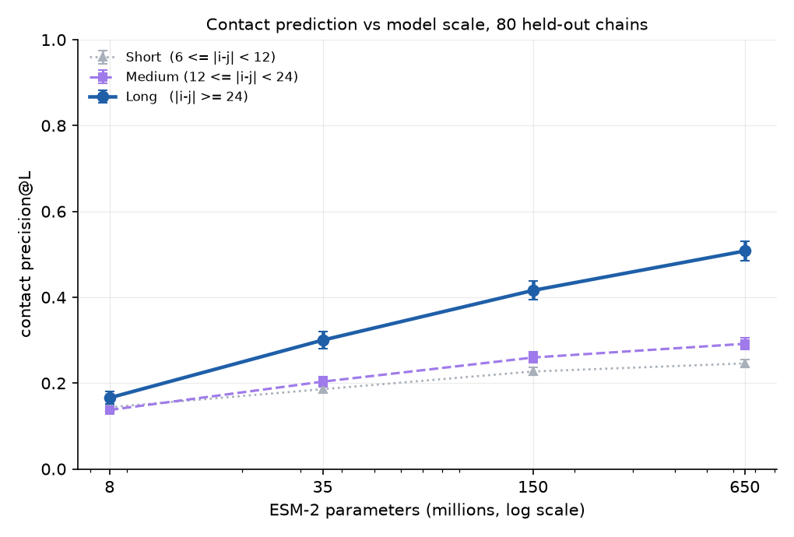

# Contact prediction vs ESM-2 scale

Long-range contact precision rises with model size across ESM-2 8M → 3B,
measured on PDB chains released after the models' training cutoff. ESM-2 is
trained only to fill in masked amino acids — it never sees a structure.



## Result

| Band | 8M | 35M | 150M | 650M | 3B |
|---|---|---|---|---|---|
| Short 6–12 | | | | | |
| Medium 12–24 | | | | | |
| Long ≥24 | | | | | |


## Run

```bash
python build_heldout.py                  # held-out set      
python contacts.py                       # verify the metric  
python check_one.py                      # one chain, one model  
python run_sweep.py --max-params 650     # the sweep           
python plot_curve.py                     # the figure  
```


## Method

- **Chains** — released after 2021-06-01, X-ray, ≤ 2.5 Å, one protein entity,
  50–400 residues, clustered at 30% sequence identity, best-resolved member per
  cluster. The date excludes both the language model's sequences and the
  contact head's training structures.
- **Ground truth** — Cβ–Cβ within 8 Å, Cα for glycine, a single named chain.
- **Metric** — precision among the top-L predicted pairs, in CASP separation
  bands.
- **No fitting** — fair-esm ships a trained contact head per checkpoint
  (`*-contact-regression.pt`). This repo evaluates it.

## Caveats

- These structures postdate training, but the model has seen homologs of their
  sequences. This measures generalization to new structures, not new folds.
- Each checkpoint carries its own fitted contact head, so strictly this compares
  (backbone + head) pairs.
- Unresolved loops mean a few sequence separations are understated, equally
  across all models.

[Lin et al. 2023](https://www.science.org/doi/10.1126/science.ade2574) ·
[Biohub/esm](https://github.com/Biohub/esm)